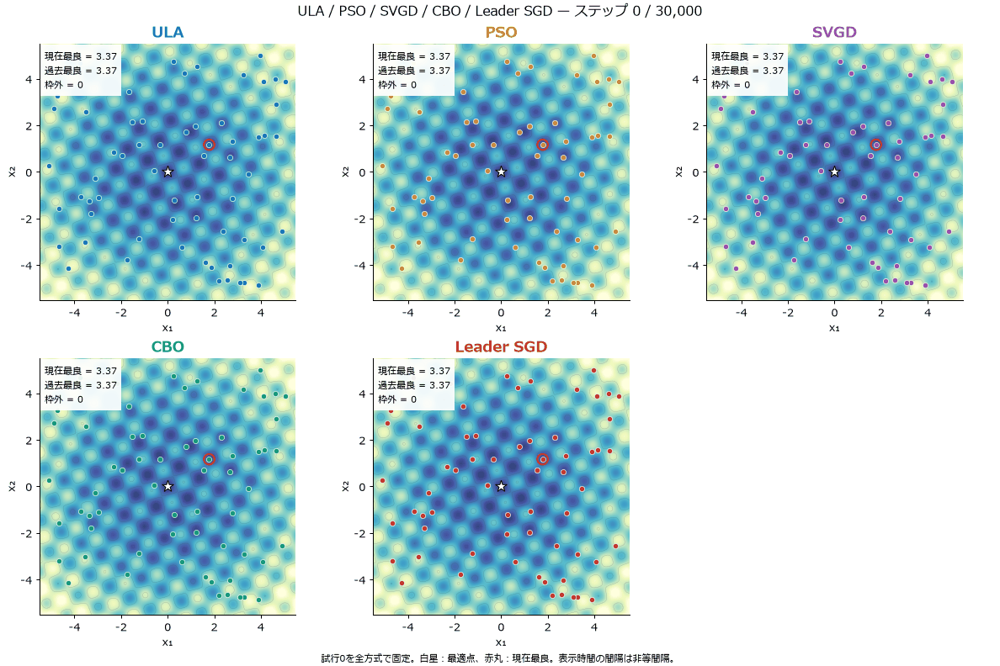

<!-- _class: lead -->
<!-- _paginate: false -->

# 研究進捗の報告

### スコアベース信念モデルによる部分観測強化学習
### Score-Based Belief Model for POMDP (Partially Observable Markov Decision Process)

 

高畠　敦

<!--
---

目次

- 強化学習と研究アイディア・進捗
- 粒子群の確率？過程 
-->

---

# 強化学習って何か

- 毎時刻の状態に対して行動をしてそれに対する報酬が定まっているとする。
- この時の「状態に対する方策(行動・戦略)決定」の学習 
- eg. マリオ
状態: マリオ・敵・アイテム・ブロック・床の位置・状態、制限時間
方策: 操作
報酬: ゴールに近くにいると毎秒+0.1点。ゴールすると+100点。死ぬと-100点。

---

# 研究の焦点
## → 状態が部分観測なときの強化学習。特に非有限の状態空間。

- 普通の強化学習では状態がすべて見える状態を考えてることが多い
- しかし現実では状態が部分観測のことも多い(というかほとんど)
- eg. マリオ
状態: マリオ・敵・アイテムの位置・制限時間
実際の観測: 画面内
方策: 操作
報酬: ゴールに近くにいると毎秒+0.1点。ゴールすると+100点。死ぬと-100点。

- 今回は特に、非有限の状態空間とすることを考える。

---

# 定義: MDP (Markov Decision Process)

組$
\mathcal{M} = (\mathcal{S}, \mathcal{A}, p_{\mathrm{T}}, r, \rho_0, \gamma)
$をMDPという。ここで、

- $\mathcal{S}$: 状態空間 (state space) (eg. マリオ・敵・アイテム・ブロック・床の位置・状態、制限時間)
- $\mathcal{A}$: 行動空間 (action space) (eg. 操作)
- $p_{\mathrm{T}}(s_{t+1} \mid s_t, a_t)$: 遷移密度 (transition density) 
- $\rho_0(s_0)$: 初期状態分布 (eg. 初期配置)
- $r(s_t, a_t)$: 報酬関数 (reward function), $\gamma \in [0, 1)$: 割引率 (discount factor)

<!--
方策 (policy) $\pi(a_t \mid s_t)$ は**状態を見て**行動を決める。目的は割引累積報酬の最大化:

$$
\max_\pi \; J(\pi) = \mathbb{E}_{\pi} \left[ \sum_{t=0}^{\infty} \gamma^t R(s_t, a_t) \right]
$$
-->

---

# 定義: POMDP (Partially Observable MDP)

組$
\mathcal{P} = (\mathcal{S}, \mathcal{A}, \mathcal{O}, p_{\mathrm{T}}, p_{\mathrm{o}}, r, \rho_0, \gamma)
$をPOMDPという。ここで、

- $\mathcal{S}$: 状態空間 (state space) (eg. 「マリオ・敵などの状態」全体の空間)
- $\mathcal{A}$: 行動空間 (action space) (eg. 操作全体)
- $\mathcal{O}$: 観測空間 (observation space) (eg. 画面の画像)
- $p_{\mathrm{T}}(s_{t+1} \mid s_t, a_t)$: 遷移密度 (transition density) (eg. ステージ全体がどう動くかの確率)
- $p_{\mathrm{o}}(o_{t+1} \mid s_{t+1}, a_t)$: 観測密度 (observation density) (eg. ステージの画面の表示の確率)
- $\rho_0(s_0)$: 初期状態分布 (eg. ステージの初期配置)
- $r(s_t, a_t)$: 報酬関数 (reward function), $\gamma \in [0, 1)$: 割引率 (discount factor)

状態 $s_t$ は見えず、観測 $o_{t+1} \sim p_{\mathrm{o}}(\cdot \mid s_{t+1}, a_t)$ だけが得られる

--- 

# 定義: 信念 (belief)

状態が見えないので、エージェントが使えるのは履歴だけ。

時刻 $t$ までの行動と観測の列 $h_t = (a_0, o_1, a_1, o_2, \dots, a_{t-1}, o_t)$ を履歴 (history) という。
履歴が与えられたときの現在の状態の事後分布 (posterior distribution)
$$
b_t(s) = p(s_t = s \mid h_t), \qquad b_0 = \rho_0
$$
を信念 (belief) という。

---

## 信念は履歴の十分統計量

- 信念は履歴の十分統計量 (sufficient statistic): 先の予測も期待報酬も、履歴全体ではなく $b_t$ だけで決まる
$$
p(s_{t+1}, o_{t+1} \mid h_t, a_t) = \int_{\mathcal{S}} p_{\mathrm{o}}(o_{t+1} \mid s_{t+1}, a_t) \, p_{\mathrm{T}}(s_{t+1} \mid s, a_t) \, b_t(s) \, ds, \qquad
\mathbb{E}[r(s_t, a_t) \mid h_t, a_t] = \int_{\mathcal{S}} r(s, a_t) \, b_t(s) \, ds
$$
- → 信念を「状態」とみなした MDP (信念 MDP, belief MDP) になり、最適な方策は $\pi(a_t \mid b_t)$ の形の中から探せばよい

--- 

# 信念のベイズ更新

$\Delta(\mathcal{S})$ を $\mathcal{S}$ 上の確率密度全体とする。写像 $\tau : \Delta(\mathcal{S}) \times \mathcal{A} \times \mathcal{O} \to \Delta(\mathcal{S})$,
$$
\tau[b, a, o](s') = \frac{p_{\mathrm{o}}(o \mid s', a) \displaystyle\int_{\mathcal{S}} p_{\mathrm{T}}(s' \mid s, a) \, b(s) \, ds}{\displaystyle\int_{\mathcal{S}} p_{\mathrm{o}}(o \mid \tilde{s}, a) \int_{\mathcal{S}} p_{\mathrm{T}}(\tilde{s} \mid s, a) \, b(s) \, ds \, d\tilde{s}}
$$
である$\tau$を信念更新作用素 (belief update operator) という。

信念はベイズ更新 (Bayesian update) で逐次に求まる: $\quad b_{t+1} = \tau[b_t, a_t, o_{t+1}]$

- $\tau$ は $\mathcal{S}$ 上の関数を関数に移す写像 → $\mathcal{S}$ が非有限 (連続) だと、線形ガウスなどの特殊な場合を除いて閉じた形では計算できない

---

# 研究アイディアと進捗
- ユークリッド空間$\mathbb{R}^N$上の状態空間で考える。
- このとき、**信念を毎時刻持つ代わりに、$b(s)$ のスコア $\nabla_{s} \log b(s)$ を持ってみる**
- 各時刻の信念bは$\mathbb{R}^N$上の関数となる
- 発想段階: スコアさえあれば(ランジェバンMCMCで)信念分布からのサンプリングができる。
- その後: ランジェバンMCMCでは各粒子を独立にサンプルするけど、多粒子だから粒子間の相互作用をうまく扱えばいいかもと思った(これが相互作用粒子系 (interacting particle system) [11] の話に)

---

# どうなるか: スコアの更新式

ベイズ更新 (前の定理) の対数を取って $s'$ で微分すると、正規化定数 (分母) が消えて
「観測の項 + 予測の項」に分かれる [1, 2]:
$$
\nabla_{s'} \log b_{t+1}(s') = \underbrace{\nabla_{s'} \log p_{\mathrm{o}}(o_{t+1} \mid s', a_t)}_{\text{観測の項}} + \underbrace{\nabla_{s'} \log \int_{\mathcal{S}} p_{\mathrm{T}}(s' \mid s, a_t) \, b_t(s) \, ds}_{\text{予測の項}}
$$

前時刻の信念を粒子で近似する ($b_t \approx \frac{1}{K} \sum_{j=1}^K \delta_{x_j}$) と、予測の項は前時刻の粒子についての重み付き平均になる:
$$
\nabla_{s'} \log \sum_{j=1}^K p_{\mathrm{T}}(s' \mid x_j, a_t) = \sum_{j=1}^K w_j(s') \, \nabla_{s'} \log p_{\mathrm{T}}(s' \mid x_j, a_t), \qquad
w_j(s') = \operatorname*{softmax}_j \big( \log p_{\mathrm{T}}(s' \mid x_j, a_t) \big)
$$

- $w_j(s')$: 点 $s'$ が前時刻の粒子 $x_j$ から来た確率 (どの粒子から遷移してきたか)

---

# エネルギー版 (energy 版)

$p_{\mathrm{T}}, p_{\mathrm{o}}$ は未知なので、対数密度にあたるスカラー関数 (エネルギー) をネットワークで置き、その勾配をスコアにする:
$$
\nabla_{s'} \log b_{t+1}(s') \approx \nabla_{s'} \Big[ \underbrace{f_\theta(o_{t+1}, s', a_t)}_{\text{観測の項}} + \underbrace{\log \sum_{j=1}^K \exp u_\theta(s', x_j, a_t)}_{\text{予測の項}} \Big]
$$

- 対応: $f_\theta$ ↔ $\log p_{\mathrm{o}}(o_{t+1} \mid s', a_t)$、$u_\theta$ ↔ $\log p_{\mathrm{T}}(s' \mid x_j, a_t)$ (どちらもスカラーを出す NN)
- 勾配は自動微分で計算する。展開すると前のページと同じ形になる:
$$
\nabla_{s'} f_\theta(o_{t+1}, s', a_t) + \sum_{j=1}^K \operatorname*{softmax}_j \big( u_\theta(s', x_j, a_t) \big) \, \nabla_{s'} u_\theta(s', x_j, a_t)
$$
- 最初の時刻は $\nabla_s \big[ g_\theta(o, s) - \tfrac{1}{2} \|s\|^2 \big]$ (標準正規の対数密度 + 観測の項)
- スカラー関数の勾配なので、必ず勾配場になる (ある密度のスコアとして解釈できる)
- 代わりに、学習ではこのスコアをもう一度微分する (2 階微分) ので重い

---

# Attention 重み版 (light 版)

$p_{\mathrm{T}}, p_{\mathrm{o}}$ は未知なので、それぞれの部品をネットワークで置き換える。エネルギー版の展開した式で、勾配 $\nabla_{s'} f_\theta$, $\nabla_{s'} u_\theta$ の部分もネットワークが直接出力する:
$$
\nabla_{s'} \log b_{t+1}(s') \approx f_\theta(o_{t+1}, s', a_t) + \sum_{j=1}^K \operatorname*{softmax}_j \big( k_\theta(s', x_j, a_t) \big) \, v_\theta(s', x_j, a_t)
$$

- 対応: $f_\theta$ ↔ 観測のスコア (ベクトル)、$k_\theta$ ↔ $\log p_{\mathrm{T}}(s' \mid x_j, a_t)$ (スカラー)、$v_\theta$ ↔ $\nabla_{s'} \log p_{\mathrm{T}}(s' \mid x_j, a_t)$ (ベクトル)
- エネルギー版との違い: $v_\theta$ が $k_\theta$ の勾配である必要がない → 勾配場とは限らないが、微分が 1 回減って軽い
- 形は Transformer の attention [10] と同じ (query = 今の点 $s'$、key / value = 前時刻の粒子 $x_j$)
- 最初の時刻は $g_\theta(o, s) - s$ (標準正規の事前分布のスコア $-s$ + 観測の項)
- 注意: 報酬と次の観測の予測で学ぶので、学習後に $k_\theta, v_\theta$ が本当に対数遷移密度とそのスコアになる保証はない

---

## 既存研究

- 既存研究はいくつかある。けどモデルフリー寄りのものは少なそう。
  - スコアでフィルタリング (遷移・観測モデルは既知): Score-based Filter [1], SSLS [2], CSF [3], Score-based Data Assimilation [4]
  - POMDP の信念を SVGD で動かす (モデル既知): ESCORT [5]
  - モデルフリーで粒子の信念を学ぶ RL (スコアは使わず、重み + 再サンプリング): PF-RNN [6], DPFRL [7]
  - 生成モデルを併用して信念を学ぶ RL: DVRL [8], FORBES [9]

---

## (参考)モデルフリーとモデルベース

- モデルベース (model-based): 環境のモデルを既知として与えるか、データから学習して、それを使って計画 (planning) や想像上の軌道の生成を行う
  - 例: POMCP (Partially Observable Monte-Carlo Planning, 既知モデルで木探索), Dreamer (世界モデルを学習)
- モデルフリー (model-free): 環境のモデル ($p_{\mathrm{T}}$, $p_{\mathrm{o}}$, $r$) を明示的に使わず、集めた経験 (報酬) から方策や価値関数を直接学ぶ
  - 例: PPO (Proximal Policy Optimization), DQN (Deep Q-Network)
- 信念で言うと
  - モデルベース: 既知 (または学習した) $p_{\mathrm{T}}, p_{\mathrm{o}}$ でベイズ更新 (前の定理) を近似計算する (粒子フィルタなど)
  - モデルフリー: $p_{\mathrm{T}}, p_{\mathrm{o}}$ を使わず、信念の表現そのものをデータから学ぶ (GRU の隠れ状態、PF-RNN [6]、DPFRL [7] など)
- 本研究は後者: 既知のモデルは使わず、スコアを方策と一緒にデータから学ぶ

---

# どうやって方策を学習するか
## 目的関数の設定
- まず初めに目的関数を定める。今回は方策 $\pi$ に従ったときの割引累積報酬の期待値 (expectation) とする:
$$
f^{\pi} = \mathbb{E}_{\pi}\left[ \sum_{t=0}^{\infty} \gamma^t r(S_t, A_t) \right]
$$
- $S_t, A_t$ は方策 $\pi$ に従ったときの状態・行動の確率変数。$\mathbb{E}_{\pi}$ はその乱数すべて ($S_0 \sim \rho_0$, $A_t \sim \pi(\cdot \mid S_t)$, $S_{t+1} \sim p_{\mathrm{T}}(\cdot \mid S_t, A_t)$) についての平均
- すなわち $\displaystyle\operatorname*{argmax}_{\pi \in \Pi} f^{\pi}$ を求めたい ($\Pi$: 方策のなす空間)
- ※ POMDP では $S_t$ が見えないので、$S_t$ を信念 $b_t$ に置き換えた信念 MDP で同じことを考える (方策は $\pi(\cdot \mid b_t)$)

---

## 方策をニューラルネットワークで
- 方策をNNで近似するとする: $\pi_\theta$
- $\displaystyle\operatorname*{argmax}_{\theta \in \Theta} f^{\pi_{\theta}}$ を求めることにする ($\Theta$: パラメータ空間)
- なので、$L(\theta) = -f^{\pi_{\theta}}$ を損失として勾配降下で $\displaystyle\operatorname*{argmin}_{\theta \in \Theta} L(\theta)$ を求めに行く

--- 

## 方策勾配アクタークリティック
- $f^{\pi_{\theta}}$ の勾配を求めると次のようになる (方策勾配定理, policy gradient theorem): 
$$
\begin{aligned}
\nabla_\theta f^{\pi_\theta} &= \mathbb{E}_{\pi_\theta}\left[ \sum_{t=0}^{\infty} \gamma^t \, \nabla_\theta \log \pi_\theta(A_t \mid S_t) \, \mathrm{Q}^{\pi_\theta}(S_t, A_t) \right] \\
&= \mathbb{E}_{\pi_\theta}\left[ \sum_{t=0}^{\infty} \gamma^t \, \nabla_\theta \log \pi_\theta(A_t \mid S_t) \, \mathrm{Adv}^{\pi_\theta}(S_t, A_t) \right]
\end{aligned}
$$
- ここで$\mathrm{V}$は状態価値関数、$\mathrm{Q}$は行動価値関数、$\mathrm{Adv}$はアドバンテージ関数と呼ばれる (次のページ)。

---

## 価値関数

$$
\begin{aligned}
\mathrm{V}^{\pi}(s) &= \mathbb{E}_{\pi}\left[ \sum_{k=0}^{\infty} \gamma^k r(S_{t+k}, A_{t+k}) \,\middle|\, S_t = s \right] \\
\mathrm{Q}^{\pi}(s, a) &= \mathbb{E}_{\pi}\left[ \sum_{k=0}^{\infty} \gamma^k r(S_{t+k}, A_{t+k}) \,\middle|\, S_t = s, A_t = a \right] \\
\mathrm{Adv}^{\pi}(s, a) &= \mathrm{Q}^{\pi}(s, a) - \mathrm{V}^{\pi}(s)
\end{aligned}
$$

- 直感的解説: 
  - 状態価値関数->状態に点数を付けたもの
  - 行動価値関数->各状態における行動に点数を付けたもの
  - アドバンテージ関数 -> 各状態で各行動が平均よりどれだけよくするかを表す
- 言いたいこと: 各方策に対して$\mathrm{Q}$か特に **$\mathrm{Adv}$が計算できれば勾配が計算できる** ことがわかる。

---

## 方策勾配アクタークリティック (続き)

- さらに、アドバンテージ関数$\mathrm{Adv}$は状態価値関数$\mathrm{V}$だけを使って書ける:
$$
\mathrm{Adv}^{\pi}(S_t, A_t) = \mathbb{E}\left[ \delta_t \mid S_t, A_t \right], \qquad \delta_t = r(S_t, A_t) + \gamma \mathrm{V}^{\pi}(S_{t+1}) - \mathrm{V}^{\pi}(S_t)
$$
- ここで、$\delta_t$はTD誤差 (temporal difference error) と呼ばれる。サンプルした $\delta_t$ を $\mathrm{Adv}$ の代わりに使える (不偏推定)
- まとめると、状態価値関数$\mathrm{V}$が計算できれば勾配を計算できることがわかる。
- じゃあ$\mathrm{V}$はどうやって計算するのか？ → $\mathrm{V}$ はベルマン方程式 (後述) という方程式を満たすので、その方程式のずれを誤差として NN で近似する

- ($\mathrm{Q}$ を NN で学習する方法もあるが) 今回は$\mathrm{V}$をNNで学習する

---

## 価値関数の学習
- 状態価値関数 $\mathrm{V}^{\pi}$ (前述) を NN $\mathrm{V}_{\phi}$ で近似する。ロス関数としてTD誤差の 2 乗を用いる (目標 $r + \gamma \mathrm{V}_{\phi}(S_{t+1})$ の側は定数として扱い、微分しない):
$$
L_{\mathrm{V}}(\phi) = \mathbb{E}\left[ \delta_t^2 \right], \qquad \delta_t = r(S_t, A_t) + \gamma \mathrm{V}_{\phi}(S_{t+1}) - \mathrm{V}_{\phi}(S_t)
$$
- これはベルマン方程式 (Bellman equation) から出てくる。期待値の中身が TD 誤差 $\delta_t$ になっている:
$$
\mathbb{E}\left[ r(S_t, A_t) + \gamma \mathrm{V}^{\pi}(S_{t+1}) - \mathrm{V}^{\pi}(S_t) \mid S_t = s \right] = 0 \qquad (\forall s \in \mathcal{S})
$$

---

## 方策関数の学習
- ロス関数としてTD誤差を重みにした対数尤度を用いる ($\delta_t$ は定数として扱い、$\theta$ では微分しない):
$$
L_{\pi}(\theta) = -\mathbb{E}\left[ \delta_t \log \pi_\theta(A_t \mid S_t) \right]
$$
- この勾配は、方策勾配定理の式 ($\mathrm{Adv}$ を $\delta_t$ で置き換え、$\gamma^t$ を省いたもの。$\gamma^t$ を省くのは実装上の慣例) の符号を反転したものになる

---

## 相互作用粒子系 (interacting particle system)

- 要約すると**確率過程により生成されたbeliefを粒子で持っていた**
- この粒子の生成の仕方をいくつか変えてみる
- ここからは、各時刻の信念の中で粒子群 $\{x_i\}_{i=1}^K$ をどう動かすか (更新則) を見る

---

## ULA (Unadjusted Langevin Algorithm)

- ランジュバン拡散 (Langevin diffusion) $dX_t = \nabla \log p(X_t) \, dt + \sqrt{2} \, dW_t$ は、適当な条件の下で $p$ を定常分布に持ち、$p$ に収束する [12]
- これを刻み幅 $\eta$ でオイラー・丸山 (Euler–Maruyama) 離散化したものが ULA:
$$
x_i^{(\ell+1)} = x_i^{(\ell)} + \eta \, \nabla \log p\big(x_i^{(\ell)}\big) + \sqrt{2 \eta} \, \xi_i^{(\ell)}, \qquad \xi_i^{(\ell)} \sim \mathcal{N}(0, I)
$$
- 第 1 項で密度の高い方へ登り、第 2 項のノイズで広がる → 釣り合って $p$ に従って散らばる
- 「Unadjusted」= メトロポリス・ヘイスティングス (Metropolis–Hastings) の補正をしない。そのため $\eta$ に応じたずれ (バイアス) が残る (補正するのが MALA)。$p$ が強対数凹などの条件で、ずれの非漸近評価がある [13]
- スコア $\nabla \log p$ だけで動き、正規化定数がいらない → 信念のスコアさえあれば使える
- 粒子どうしは独立 (相互作用なし)

---

## SVGD (Stein Variational Gradient Descent)

粒子 $\{x_i\}_{i=1}^n$ を、カーネル $k$ (例: RBF $k(x, y) = \exp(-\|x - y\|^2 / 2h^2)$) で結んで同時に動かす [14]:
$$
x_i \leftarrow x_i + \epsilon \, \hat{\phi}^*(x_i), \qquad
\hat{\phi}^*(x) = \frac{1}{n} \sum_{j=1}^n \Big[ \underbrace{k(x_j, x) \, \nabla_{x_j} \log p(x_j)}_{\text{引力}} + \underbrace{\nabla_{x_j} k(x_j, x)}_{\text{斥力}} \Big]
$$

- 引力項: 近くの粒子のスコアをカーネルで重み付けした平均 → 密度の高い方へ
- 斥力項: RBF なら $\nabla_{x_j} k(x_j, x) = \frac{x - x_j}{h^2} k(x_j, x)$ → 近い粒子から離れる (全粒子が 1 点に潰れない)
- ノイズは使わない (決定的)。粒子が 1 個なら斥力が消えて、ただの勾配上昇 (MAP 推定) になる
- ULA はノイズで広がり、SVGD は粒子間の斥力で広がる

---

## 平均場極限 (mean-field limit) とは

粒子 $x_1, \dots, x_N$ が、自分の位置と粒子全体の経験分布 (empirical measure) $\hat{\mu}^N_t = \frac{1}{N} \sum_{j=1}^N \delta_{x_j(t)}$ だけで決まる速度で動く系を考える:
$$
\frac{d x_i}{dt} = F\big(x_i, \hat{\mu}^N_t\big) \qquad (i = 1, \dots, N)
$$

初期の経験分布が $\hat{\mu}^N_0 \to \mu_0$ と弱収束 (weak convergence) するとき、各時刻 $t$ で
$$
\hat{\mu}^N_t \to \mu_t \quad (N \to \infty,\ \text{弱収束}), \qquad \partial_t \mu_t = -\nabla \cdot \big( \mu_t \, F(\cdot, \mu_t) \big)
$$
となる確率測度の流れ $(\mu_t)_{t \ge 0}$ を、この粒子系の平均場極限という。右の式を平均場方程式という。

- 弱収束: 任意の有界連続関数 $g$ で $\frac{1}{N} \sum_j g(x_j(t)) \to \int g \, d\mu_t$
- 意味: 粒子が無限個あると、個々の粒子ではなく「密度」$\mu_t$ が 1 本の偏微分方程式 (連続の式) に従って流れる。各粒子は、他の粒子すべてが作る平均的な場 $F(\cdot, \mu_t)$ の中を動く
- SVGD では $F(x, \mu) = \phi^*_{\mu, p}(x) = \mathbb{E}_{y \sim \mu}\big[ k(y, x) \, \nabla_y \log p(y) + \nabla_y k(y, x) \big]$ (粒子についての和が、$\mu$ についての期待値になる)
- 離散時間 (反復 $\ell$) の場合も同様に、各反復で $\hat{\mu}^N_\ell \to \mu^\ell$ となることをいう

---

## SVGD の平均場極限

(1) 初期粒子の経験分布が $\mu^0$ に弱収束するなら、各反復 $\ell$ で粒子の経験分布 $\hat{\mu}_n^{\ell}$ は $n \to \infty$ で平均場の分布 $\mu^{\ell}$ に弱収束する。$\mu^{\ell}$ は $\mu^{\ell+1} = (\mathrm{id} + \epsilon \, \phi^*_{\mu^{\ell}, p})_{\#} \, \mu^{\ell}$ に従う

(2) 連続時間 ($\epsilon \to 0$) では $\partial_t \mu_t = -\nabla \cdot (\mu_t \, \phi^*_{\mu_t, p})$ となり、
$$
\frac{d}{dt} \mathrm{KL}(\mu_t \,\|\, p) = - \mathbb{S}(\mu_t, p)^2 \le 0
$$

- $\mathbb{S}$: カーネル化スタイン不一致 (KSD, kernelized Stein discrepancy) [17]。適切なカーネルなら $\mathbb{S}(\mu, p) = 0 \Leftrightarrow \mu = p$
- つまり無限粒子では KL が単調に減り、止まるのは $\mu = p$ のときだけ → 元の分布からのサンプリングになる
- ただし「KL が減り続ける」だけでは $p$ への収束は言えない → 条件付きの収束定理は次のページ

---

## SVGD の平均場極限: $t \to \infty$ での収束 (1) 弱収束

$\mu_t$ を平均場の流れ $\partial_t \mu_t = -\nabla \cdot (\mu_t \, \phi^*_{\mu_t, p})$ の解、$p \propto e^{-V}$ とする。

カーネルが平行移動不変 $k(x, y) = K(x - y)$ で、次を満たすとする:
- $K$ は $C^4$ 級で導関数が有界、かつ $K = K^{1/2} * K^{1/2}$ ($*$: 畳み込み) と書けて $K^{1/2}$ のフーリエ変換が 0 にならない (例: ガウスカーネル)
- ポテンシャル $V$ が増大度・滑らかさの条件 ([16] の Assumption 2) を満たす
- 初期分布 $\mu_0$ が $\mathrm{KL}(\mu_0 \,\|\, p) < \infty$ などの可積分性の条件を満たす

このとき $t \to \infty$ で $\mu_t \to p$ (弱収束)。

- 別の見方: $\frac{d}{dt} \mathrm{KL} = -\mathbb{S}^2$ を積分すると、条件なしで $\displaystyle \min_{0 \le s \le t} \mathbb{S}(\mu_s, p)^2 \le \frac{\mathrm{KL}(\mu_0 \,\|\, p)}{t}$ (KSD は時間平均の意味で 0 へ)
- これを分布の収束にするには「KSD → 0 ならば弱収束」が要る。IMQ カーネル $k(x, y) = (c^2 + \|x - y\|^2)^{\beta}$ ($c > 0$, $-1 < \beta < 0$) と、裾で強対数凹な $p$ (distantly dissipative) なら成り立つ [24, Thm 8]
- 逆にガウスカーネルなど裾の軽いカーネルでは、$d \ge 3$ だと KSD → 0 でも収束しない例がある [24, Thm 6]

---

## SVGD の平均場極限: $t \to \infty$ での収束 (2) 収束の速さ

ある $\lambda > 0$ ですべての $\mu$ について
$$
\mathrm{KL}(\mu \,\|\, p) \le \frac{1}{2\lambda} \, I_{\mathrm{Stein}}(\mu \,\|\, p), \qquad I_{\mathrm{Stein}}(\mu \,\|\, p) = \|\phi^*_{\mu, p}\|_{\mathcal{H}^d}^2 = \mathbb{S}(\mu, p)^2
$$
(スタイン対数ソボレフ不等式, $I_{\mathrm{Stein}}$: スタイン・フィッシャー情報量) が成り立つなら、
$$
\mathrm{KL}(\mu_t \,\|\, p) \le e^{-2\lambda t} \, \mathrm{KL}(\mu_0 \,\|\, p)
$$

- 証明: $\frac{d}{dt} \mathrm{KL} = -I_{\mathrm{Stein}} \le -2\lambda \, \mathrm{KL}$ にグロンウォールの不等式
- **ただし、この不等式は仮定であって、多くの場合に成り立たない** [25]
  - $C^{1,1}$ 級で可積分性の条件を満たすカーネルでは、$\lambda = 0$ でしか成り立たない [25, Lemma 39]
  - 1 次元で、遠方で値と導関数が 0 に近づく平行移動不変カーネル (ガウスなど) では、平衡点の近くでも指数収束しない [25, Corollary 42]
- まとめ: 平均場では「条件付きで $p$ に弱収束する」までは言えるが、速さの一般的な保証はない。有限粒子・有限ステップの保証はさらに弱い [18]

---

## SVGDのアルゴリズムはどこから来たか？ (1)

分布 $q$ の粒子を写像 $T(x) = x + \epsilon \, \phi(x)$ で動かしたときの分布を $q_{[T]}$ とする。
KL が一番速く減る向き $\phi$ を探したい。

$$
\frac{d}{d\epsilon} \mathrm{KL}\big(q_{[T]} \,\|\, p\big) \Big|_{\epsilon = 0} = - \mathbb{E}_{x \sim q}\big[ \mathcal{A}_p \phi(x) \big], \qquad
\mathcal{A}_p \phi(x) = \phi(x)^\top \nabla_x \log p(x) + \nabla_x \cdot \phi(x)
$$

- $\mathcal{A}_p$: スタイン作用素 (Stein operator)。$q = p$ なら右辺は 0 (スタインの恒等式, Stein's identity)
- 第 1 項 $\phi^\top \nabla \log p$: 密度の高い方へ動くと KL が減る → **引力項の起源**
- 第 2 項 $\nabla \cdot \phi$: 写像で体積が広がる (エントロピーが増える) と KL が減る → **斥力項の起源**
- 問題: $\phi$ はどんな関数でもよいので、「一番よい $\phi$」を決めるには関数の空間を決める必要がある

---

## SVGDのアルゴリズムはどこから来たか？ (2)

$\phi$ を、カーネル $k$ の再生核ヒルベルト空間 (RKHS, reproducing kernel Hilbert space) $\mathcal{H}^d$ から選ぶ。

$\|\phi\|_{\mathcal{H}^d} \le 1$ の中で $\mathbb{E}_q[\mathcal{A}_p \phi]$ を最大にする向きは $\phi^*_{q,p} / \|\phi^*_{q,p}\|_{\mathcal{H}^d}$ で、
$$
\phi^*_{q,p}(\cdot) = \mathbb{E}_{x \sim q}\big[ k(x, \cdot) \, \nabla_x \log p(x) + \nabla_x k(x, \cdot) \big]
$$
最大値は $\|\phi^*_{q,p}\|_{\mathcal{H}^d} = \mathbb{S}(q, p)$ (KSD)。また $-\phi^*_{q,p}$ は、KL を $\phi \in \mathcal{H}^d$ の汎関数とみたときの勾配 (関数勾配) に一致する。

- 理由: 再生性 $\phi(x) = \langle \phi, k(x, \cdot) \rangle_{\mathcal{H}}$ から $\mathbb{E}_q[\mathcal{A}_p \phi] = \langle \phi, \phi^*_{q,p} \rangle_{\mathcal{H}^d}$。内積を最大にする単位ベクトルは $\phi^*$ の向き (リースの表現定理)
- つまり SVGD は、**RKHS という無限次元空間での KL の勾配降下**
- $q$ を粒子の経験分布 $\frac{1}{n} \sum_j \delta_{x_j}$ に置き換えると、前のページの更新式 $\hat{\phi}^*$ になる

--- 

## その他: 最適化のための粒子法 (PSO, CBO, Leader SGD)

目的は $f$ の最小点を探すこと (分布を表すのではなく、全粒子が最良点に集まる)。

- **PSO (Particle Swarm Optimization)** [19, 20]: 速度 $v_i$ を持ち、自分の過去最良 $p_i$ と群れ全体の過去最良 $g$ に引かれる。勾配を使わない
$$
v_i \leftarrow \chi \big[ v_i + c_1 r_1 \odot (p_i - x_i) + c_2 r_2 \odot (g - x_i) \big], \quad x_i \leftarrow x_i + v_i \qquad (r_1, r_2 \sim U[0, 1]^d)
$$
- **CBO (Consensus-Based Optimization)** [21, 22]: 損失で重み付けした「合意点」$m_\alpha$ に引かれ、合意点から遠いほど大きなノイズを受ける。勾配を使わない。$\alpha \to \infty$ で $m_\alpha$ は最良粒子に近づく (ラプラスの原理)。平均場極限での解析がある
$$
m_\alpha = \frac{\sum_i x_i \, e^{-\alpha f(x_i)}}{\sum_i e^{-\alpha f(x_i)}}, \qquad dX_i = -\lambda (X_i - m_\alpha) \, dt + \sigma \|X_i - m_\alpha\| \, dW_i
$$
- **Leader SGD (LSGD)** [23]: 各粒子は勾配降下しつつ、現在の最良粒子 (リーダー) $\tilde{x}$ に引かれる。元は分散学習 (複数ワーカー) の手法。CBO の $\alpha \to \infty$ (合意点 = 最良粒子) で、ノイズの代わりに勾配を使う形とみなせる
$$
x_i \leftarrow x_i - \eta \, \nabla f(x_i) - \lambda (x_i - \tilde{x}), \qquad \tilde{x} = x_{\arg\min_j f(x_j)}
$$

---

## それぞれの粒子の挙動

- 課題: 2 次元の回転 Rastrigin 関数 (最小点は原点)
- 64 粒子・30,000 ステップ・48 試行、初期位置は全方式で共通
- ULA・SVGD の目標分布は $p \propto e^{-f / 0.5}$

| | $f < 0.01$ 到達 | 最終の広がり |
|:-:|:-:|:-:|
| ULA | 25 / 48 | 4.17 |
| PSO | 48 / 48 | ≈ 0 |
| SVGD | 18 / 48 | 4.14 |
| CBO | 48 / 48 | ≈ 0 |
| Leader SGD | 27 / 48 | 2.81 |

- ULA・SVGD は分布に広がったまま、PSO・CBO は 1 点に集まる。Leader SGD は局所的な谷に捕まった粒子が残る
- Leader SGD は今回追加 ($\eta = 0.001$, $\lambda = 0.01$、調整なし)
- 単一の課題・係数設定での例で、一般的な順位ではない

---

<!-- _class: lead -->

# 実験: light 版 vs energy 版

---

## 実験: 比べるもの

スコアの出し方だけを変えて、同じ条件で比べる。

| | energy 版 | light 版 (direct) |
|---|---|---|
| スコアの出し方 | スカラーのエネルギー $E_\theta$ を NN で出し、自動微分で $-\nabla_x E_\theta$ | NN がスコアのベクトルを直接出力 (Attention 重み版の式) |
| 勾配場か | 必ず勾配場 (ある密度のスコアになりうる) | 勾配場とは限らない |
| 計算 | 学習時に 2 階微分が要る | 2 階微分が不要 → 1 update の時間が約 1/3 |

- 共通の設定: 粒子数 $K = 16$、各時刻に粒子を動かす回数 12 段、サンプラーは ULA / SVGD、方策の学習は PPO (Proximal Policy Optimization)
- 学習の流れ: ランダム方策で次の観測の予測を事前学習 → PPO → 予測 → PPO … を交互に
- 基準線: GRU (Gated Recurrent Unit)、粒子フィルタ PF (DPFRL 型 [7])。行動 1 step の計算量 (FLOPs) をスコア版にそろえた幅
- 課題 (どれも信念が多峰になる連続状態の POMDP)
  - mirror2: 鏡像の曖昧さがある Mountain Hike (どの鏡像にいるかが観測だけでは決まらない)
  - tps: 原点からの距離 $|s|$ だけが見える + テレポート
  - tagr: 鬼ごっこ (鬼までの距離だけがノイズ付きで見える)
- 評価: 学習後の決定的評価のリターン (高いほど良い)、seed 10〜14 の 5 本 (本数が違うものは表に明記)

---

## モデルの構造: ULA 版と SVGD 版

1 時刻の処理の流れ (ULA 版と SVGD 版で共通。違うのは **3. 粒子の更新** だけ):

1. **スコア場を作る**: 観測 $o_{t+1}$、行動 $a_t$、前時刻の粒子 $\{x_j^{t}\}_{j=1}^{K}$ から、スコア場 $\mathfrak{s}_{t+1}(\cdot)$ を作る (energy 版 / light 版の式)
2. **粒子の初期化**: 標準正規分布から $K = 16$ 個の点 $x_i^{(0)} \sim \mathcal{N}(0, I)$ を引く (前時刻の粒子からは始めない)
3. **粒子の更新**: スコア場に沿って 12 段動かす ($\ell = 0, \dots, 11$、刻み幅 $\alpha_\ell$ は 0.2 から学習)
4. **読み出し**: 粒子とその点でのスコアの組の集合 $\{(x_i, \mathfrak{s}_{t+1}(x_i))\}_{i=1}^{K}$ を、順序によらないエンコーダ (Set Transformer) で 1 本のベクトル $c_{t+1}$ にまとめる
5. **方策と価値**: $c_{t+1}$ から行動 (拡散方策 (diffusion policy)、5 段) と価値 $\mathrm{V}$ を出す → PPO で学習

| 3. 粒子の更新 | ULA 版 | SVGD 版 |
|:-:|---|---|
| 更新式 | $x_i \leftarrow x_i + \alpha_\ell \, \mathfrak{s}(x_i) + \beta \, \xi_i$, $\ \xi_i \sim \mathcal{N}(0, I)$, $\beta = 0.2$ | $x_i \leftarrow x_i + \frac{\alpha_\ell}{K} \sum_j \big[ k(x_j, x_i) \, \mathfrak{s}(x_j) + \nabla_{x_j} k(x_j, x_i) \big]$ |
| 粒子どうしの関係 | 独立 (1 個ずつ別々に動く) | カーネル $k(x, y) = e^{-\|x - y\|^2 / h}$ で互いに作用 ($h$ は中央値で決める) |
| 広がりを保つ仕組み | ノイズ | 粒子間の斥力 (ノイズなし) |
| 計算量 | 粒子数 $K$ に比例 | $K^2$ に比例 (全ペア) |

- 学習では、3 の 12 段と時間方向の連鎖をすべて通して逆伝播する (方策の損失がスコア場まで届く)
- 2 のノイズは保存しておき、PPO の更新時に同じ粒子を再現する

---

## 基準線 (既存研究) との構造の比較

| | GRU | PF (粒子フィルタ, DPFRL 型 [7]) | スコア版 (本研究) |
|:-:|---|---|---|
| 信念の持ち方 | 1 本の隠れベクトル $h_t$ (160 次元) | 重み付きの粒子 $\{(x_i, w_i)\}_{i=1}^{16}$ (各 16 次元) | 重みなしの粒子 $\{x_i\}_{i=1}^{16}$ (状態と同じ次元) とスコア場 |
| 1 時刻の更新 | $h_{t+1} = \mathrm{GRU}(h_t, o_{t+1}, a_t)$ | 各粒子を学習した遷移で動かす → 観測との適合度で重みを更新 → ソフトな再サンプリング | 前時刻の粒子からスコア場を作る → ノイズから ULA / SVGD で 12 段動かす |
| 観測の入り方 | ゲートを通して隠れベクトルに混ぜる | 重みを通して (合う粒子を重くする) | スコア場の観測の項を通して (粒子を合う場所へ動かす) |
| 時間方向の記憶 | $h_t$ そのもの | 粒子と重み | 前時刻の粒子 (予測の項の中だけに現れる) |
| 方策への渡し方 | $h_t$ をそのまま | 粒子の重み付き平均と MGF (moment generating function) 特徴 | 粒子とスコアの集合を Set Transformer でまとめる |
| 多峰な信念 | 隠れベクトル次第 (構造上の保証なし) | 粒子が複数の山に分かれれば表せる | 粒子が複数の山に分かれれば表せる |
| ベイズ更新との対応 | なし (汎用の再帰) | 予測 → 重み付け → 再サンプリングが粒子フィルタに対応 | 「観測の項 + 予測の項」がベイズ更新の対数微分に対応 |

- 方策の頭 (拡散方策)、PPO、学習の流れ (予測の事前学習 → PPO を交互) は 3 つとも同じ
- 行動 1 step の推論の計算量 (FLOPs) は、基準線の幅を広げてスコア版にそろえてある
- どれも既知の $p_{\mathrm{T}}, p_{\mathrm{o}}$ と真の状態は使わない。PF・スコア版の「対応」は構造の話で、学習後に本当にベイズ更新になる保証はない

---

## 計算時間の差

1 update (全環境 128 step のロールアウト 1 回 + 16 回の最適化ステップ) にかかる実時間 (秒)。同じ GPU・同じ旧コードでの実測。

| サンプラー | energy 版 | light 版 | light / energy |
|:-:|:-:|:-:|:-:|
| ULA | 466〜608 | 162〜176 | 約 0.3 倍 |
| SVGD | 750〜953 | 272〜295 | 約 0.3 倍 |

| 基準線 | GRU | PF |
|:-:|:-:|:-:|
| 1 update (秒) | 3〜4 | 13〜15 |

- light 版は energy 版の約 1/3: energy 版はスコアを自動微分で作るので、学習時にその上からもう一度微分する (2 階微分) のが重い
- SVGD は粒子の全ペアのカーネルを計算する分だけ ULA より重い
- それでも light SVGD は GRU の約 80 倍、PF の約 20 倍の時間がかかる
- 注意: 行動 1 step の推論の計算量 (FLOPs) は基準線とそろえてある。差が出ているのは学習時 (信念の連鎖を通した逆伝播)
- 現在のコードは高速化済み (スコアの解析的な微分など) で、絶対値はこれより短い。比はこの旧コードでの値

---

## 結果の一覧: モデルごとの比較

学習後の決定的評価のリターン (平均 ± 標準偏差、高いほど良い)。seed は 5 本、( ) の付いたものはその本数。

| モデル | 信念の持ち方 | mirror2 | tps | tagr | 1 update の時間 (秒) |
|---|---|:-:|:-:|:-:|:-:|
| GRU | 隠れベクトル | −697 ± 748 | −298 ± 25 | **4.21 ± 1.46** | 3〜4 |
| RNN | 隠れベクトル | −781 ± 476 | −340 ± 41 | 3.18 ± 0.76 | — |
| PF (DPFRL 型) | 重み付き粒子 | −770 ± 462 | −307 ± 48 | 3.02 ± 0.45 | 13〜15 |
| PF (観測の適合度を MLP に) | 重み付き粒子 | −1290 ± 644 | −311 ± 39 | 3.53 ± 0.79 | — |
| energy ULA | スコア場 + 粒子 | −821 ± 475 | −311 ± 30 | 2.45 ± 0.59 (3) | 466〜608 |
| energy SVGD | スコア場 + 粒子 | −957 ± 692 | −326 ± 34 | 2.26 ± 0.33 (3) | 750〜953 |
| light ULA | スコア場 + 粒子 | −893 ± 499 | −296 ± 26 | — | 162〜176 |
| light SVGD | スコア場 + 粒子 | **−368 ± 22** | **−287 ± 20** | 2.30 ± 0.14 (2) | 272〜295 |

- mirror2: light SVGD が平均で最良、かつばらつきが最小。ほかは seed によって崩壊 (−1000 未満) するものがあり、標準偏差が大きい
- tps: 全モデルが −287〜−340 の帯に入り、有意な差はない
- tagr: GRU が最良。スコア版は energy も light も 2.3〜2.5 で、基準線に届かない
- 「—」は未実行または未計測。時間は旧コードでの実測で、基準線とスコア版の推論の計算量 (FLOPs) はそろえてある
- 多重比較の補正 (Holm 法) をかけると、スコア版が基準線より有意に良いと言える比較はない

---

## 結果 (1): mirror2 (333 update)

平均 ± 標準偏差 (5 seed)。「崩壊」は リターン < −1000 (領域の外に出たまま戻らない) の seed 数。

| サンプラー | energy 版 | 崩壊 | light 版 | 崩壊 |
|:-:|:-:|:-:|:-:|:-:|
| ULA | −821 ± 475 | 2/5 | −893 ± 499 | 1/5 |
| SVGD | −957 ± 692 | 2/5 | **−368 ± 22** | **0/5** |

| 基準線 (FLOPs をそろえた幅) | リターン | 崩壊 |
|:-:|:-:|:-:|
| GRU | −697 ± 748 (中央値 −282) | 1/5 |
| PF | −770 ± 462 | 1/5 |

- **light SVGD が一番安定** (seed 間の標準偏差が 22 と小さく、崩壊なし)。energy 版は SVGD で light より悪く、seed によるばらつきが大きい
- ULA では energy と light に差がない → light の良さは「SVGD と組み合わせたとき」に出ている
- ただし GRU の良い seed (−142〜−282) には届いていない。多重比較の補正 (Holm 法) をかけると、PF より有意に良い腕もない
- 計算時間は GRU・PF より 1〜2 桁重い (前のページ)

---

## 結果 (2): tps と tagr

**tps (213 update)**: どの腕も同じ帯に入り、差がつかない。

| | ULA | SVGD | GRU | PF |
|:-:|:-:|:-:|:-:|:-:|
| energy 版 | −311 ± 30 | −326 ± 34 | −298 ± 25 | −307 ± 48 |
| light 版 | −296 ± 26 | −287 ± 20 | | |

**tagr (1293 update)**: スコア版は energy も light も基準線に届かない。

| energy ULA | energy SVGD | light SVGD | GRU | PF (観測を MLP に) |
|:-:|:-:|:-:|:-:|:-:|
| 2.45 (3 seed) | 2.26 (3 seed) | 2.30 (2 seed) | 4.21 ± 1.46 | 3.53 ± 0.79 |

- tps: 最良と最悪の差が 40 以内で、どの比較も有意でない ($p \ge 0.13$)。この課題では方式の違いが見えない
- tagr: GRU が最良。energy 版の方策は加速せず止まったままの seed が多い。light 版は動くが、鬼から離れる向きには動けていない
- tagr の light / energy は seed 数が 2〜3 と少ないので、順位は確定ではない

<!--
---

## なぜ差が出るか (学習後の診断) とまとめ

- **粒子の動き方が違う** (mirror2、12 段の途中経過を記録)
  - energy 版: 粒子はほとんど動かない (12 段で重心の移動 0.2〜0.8)。段数を 0 / 6 / 12 / 24 と変えてもリターンは同じ → 方策は粒子の「位置」ではなく、その点での「スコアの値」を読んでいる
  - light 版: 12 段でほぼ等速直線の輸送 (重心の移動 1〜4)。段数を増やすと発散する
- **light 版のスコア場は勾配場ではない**: ヤコビアンの反対称成分が 47〜57 % (energy 版は構造上 0)。→ 「ある分布のスコア」にはなっておらず、SVGD の「$p$ からのサンプリング」という解釈は成り立っていない
- **どちらも記憶をほとんど使っていない**: 前時刻の粒子をノイズに置き換えても、多くの seed でリターンが変わらない。隠れた変数 (鏡像のどちら側か) は粒子から復号できない

**まとめ**
- light 版は energy 版より軽く (約 1/3)、mirror2 の SVGD では明確に安定する。tps・tagr では差がない
- ただし良くなった理由は「より正しい信念になったから」ではなさそう。light 版は勾配場の制約がない分、方策に都合のよい輸送を学べている、というのが今の見立て
- 課題: GRU に届いていない。信念として働かせる (時間方向の記憶を使わせる) 学習目的が必要

-->

---

## 参考文献 (1/2)

1. F. Bao, Z. Zhang, G. Zhang, "A score-based filter for nonlinear data assimilation," *J. Comput. Phys.*, 2024.
2. Z. Ding et al., "Nonlinear Assimilation with Score-based Sequential Langevin Sampling (SSLS)," arXiv:2411.13443, 2024.
3. Z. Zeng et al., "An Efficient Conditional Score-based Filter (CSF) for High Dimensional Nonlinear Filtering Problems," arXiv:2509.19816, 2025.
4. F. Rozet, G. Louppe, "Score-based Data Assimilation," NeurIPS, 2023.
5. Y. Zhang et al., "ESCORT: Efficient Stein-variational (SVGD: Stein Variational Gradient Descent) and Sliced Consistency-Optimized Temporal Belief Representation for POMDPs," NeurIPS, 2025.
6. X. Ma et al., "Particle Filter Recurrent Neural Networks (PF-RNN)," AAAI, 2020.
7. X. Ma et al., "Discriminative Particle Filter Reinforcement Learning (DPFRL) for Complex Partial Observations," ICLR, 2020.
8. M. Igl et al., "Deep Variational Reinforcement Learning (DVRL) for POMDPs," ICML, 2018.
9. X. Chen et al., "Flow-based Recurrent Belief State Learning (FORBES) for POMDPs," ICML, 2022.
10. A. Vaswani et al., "Attention Is All You Need," NeurIPS, 2017.
11. P. Del Moral, *Feynman-Kac Formulae: Genealogical and Interacting Particle Systems with Applications*, Springer, 2004.

---

## 参考文献 (2/2)

12. G. O. Roberts, R. L. Tweedie, "Exponential convergence of Langevin distributions and their discrete approximations," *Bernoulli*, 1996.
13. A. Durmus, É. Moulines, "Non-asymptotic convergence analysis for the Unadjusted Langevin Algorithm," arXiv:1507.05021 (*Ann. Appl. Probab.*, 2017).
14. Q. Liu, D. Wang, "Stein Variational Gradient Descent: A General Purpose Bayesian Inference Algorithm," NeurIPS, 2016.
15. Q. Liu, "Stein Variational Gradient Descent as Gradient Flow," NeurIPS, 2017.
16. J. Lu, Y. Lu, J. Nolen, "Scaling limit of the Stein variational gradient descent: the mean field regime," *SIAM J. Math. Anal.*, 2019 (arXiv:1805.04035).
17. Q. Liu, J. D. Lee, M. I. Jordan, "A Kernelized Stein Discrepancy for Goodness-of-fit Tests," ICML, 2016.
18. A. Korba, A. Salim, M. Arbel, G. Luise, A. Gretton, "A Non-Asymptotic Analysis for Stein Variational Gradient Descent," NeurIPS, 2020.
19. J. Kennedy, R. Eberhart, "Particle swarm optimization," *Proc. ICNN'95*, 1995.
20. M. Clerc, J. Kennedy, "The particle swarm — explosion, stability, and convergence in a multidimensional complex space," *IEEE Trans. Evol. Comput.*, 2002.
21. R. Pinnau, C. Totzeck, O. Tse, S. Martin, "A consensus-based model for global optimization and its mean-field limit," *Math. Models Methods Appl. Sci.*, 2017.
22. J. A. Carrillo, Y.-P. Choi, C. Totzeck, O. Tse, "An analytical framework for a consensus-based global optimization method," *Math. Models Methods Appl. Sci.*, 2018.
23. Y. Teng, W. Gao, F. Chalus, A. Choromanska, D. Goldfarb, A. Weller, "Leader Stochastic Gradient Descent for Distributed Training of Deep Learning Models," NeurIPS, 2019.
24. J. Gorham, L. Mackey, "Measuring Sample Quality with Kernels," ICML, 2017 (arXiv:1703.01717).
25. A. Duncan, N. Nüsken, L. Szpruch, "On the geometry of Stein variational gradient descent," *J. Mach. Learn. Res.*, 24(56), 2023 (arXiv:1912.00894).
